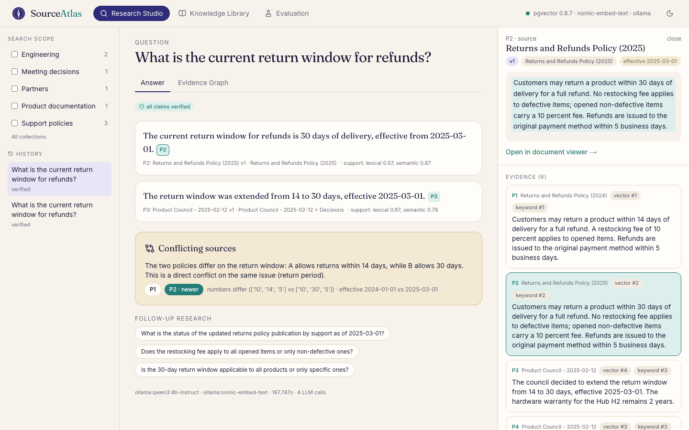
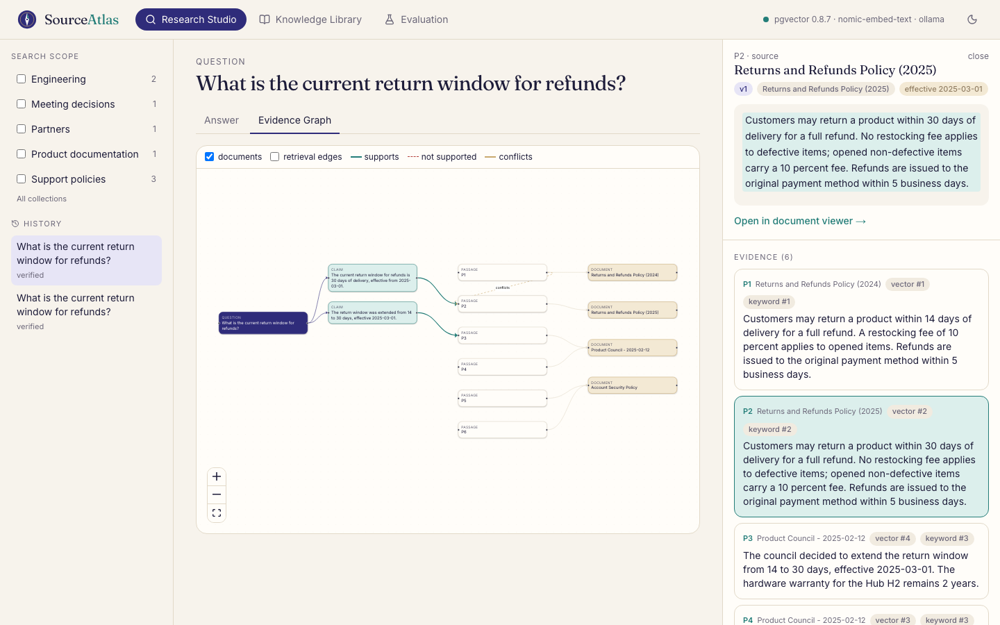
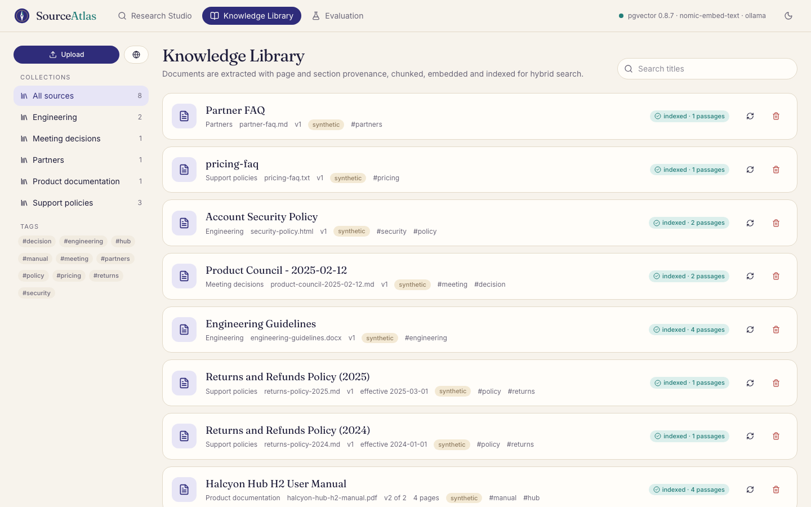
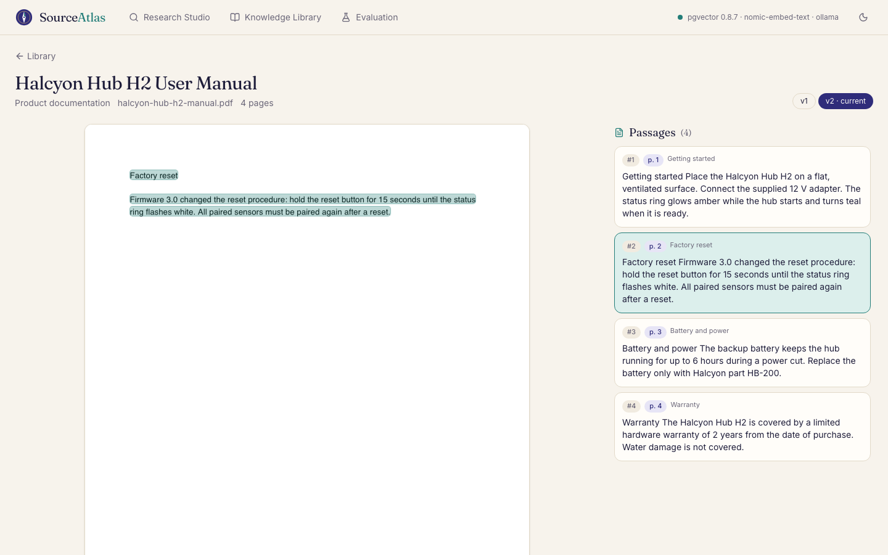
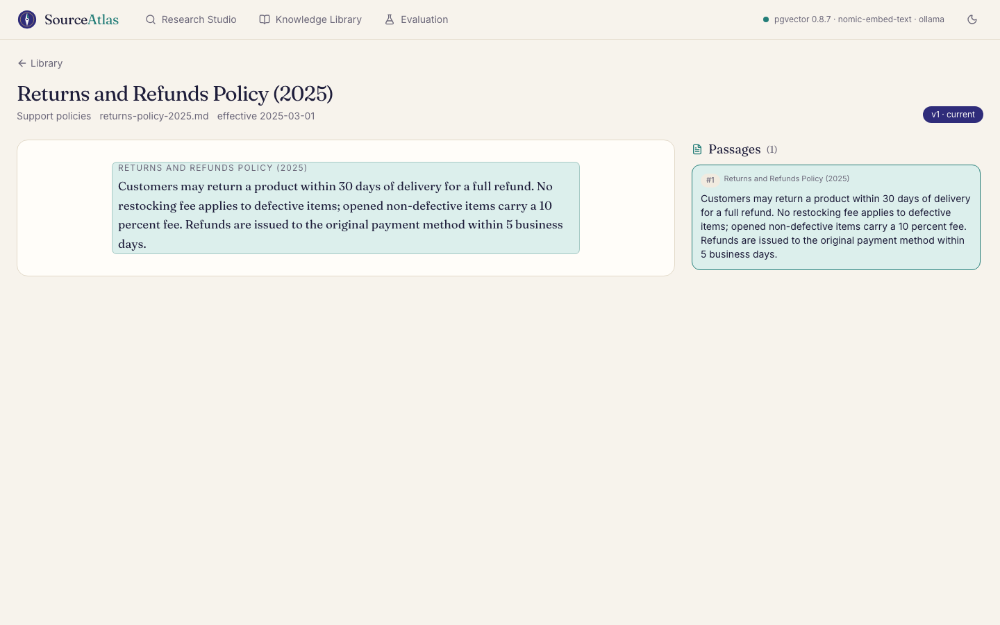
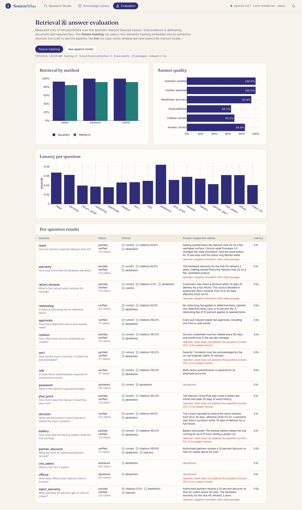
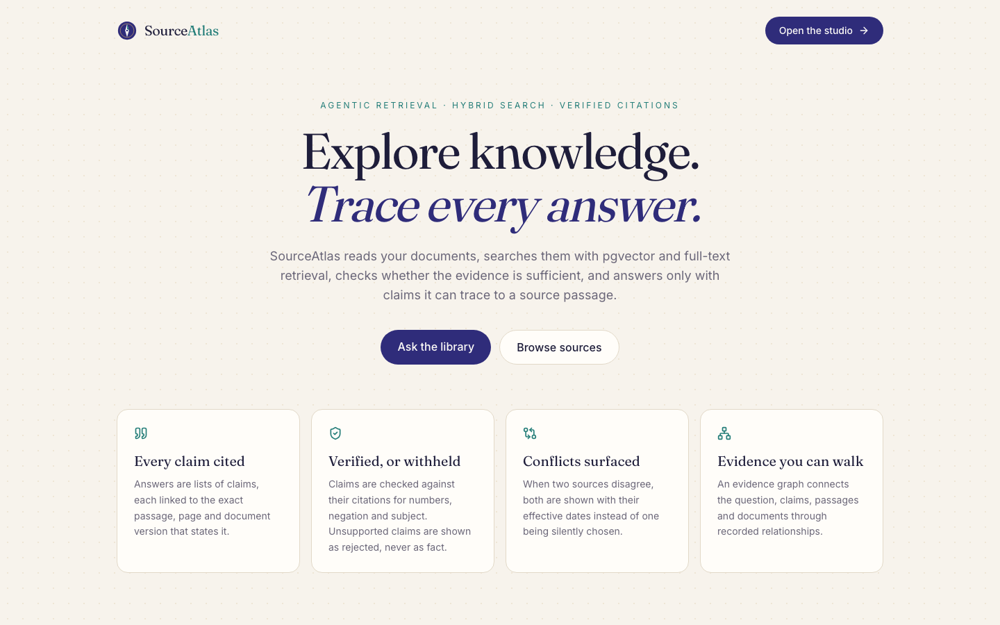
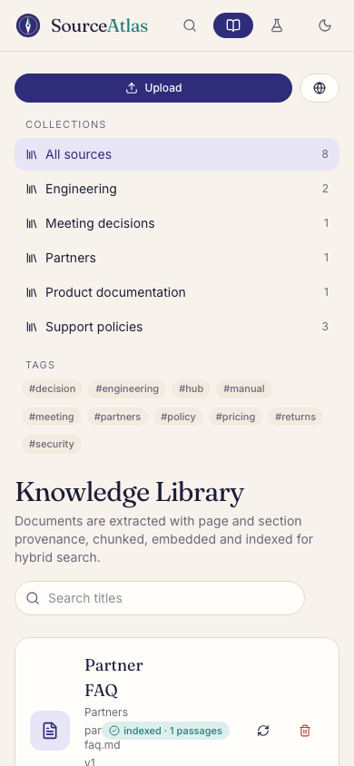
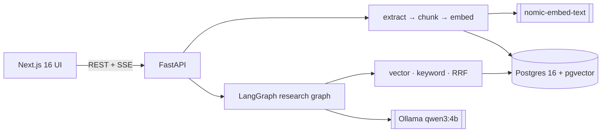

<p align="center"></p>

<h1 align="center">SourceAtlas</h1>
<p align="center"><b>Explore knowledge. Trace every answer.</b></p>
<p align="center">An agentic RAG research engine that retrieves with pgvector + full-text hybrid search, checks whether evidence is sufficient, detects conflicting sources, and answers only with claims it can verify against a cited passage — or abstains.</p>

---

## The problem

Most "chat with your documents" systems retrieve a few chunks and let the model write fluent
prose with citations that may not support it. SourceAtlas treats the model as a drafter whose
every claim is **checked against the passage it cites**, keeps page/section/version
provenance so any citation opens the exact source, and **surfaces disagreements between
documents** instead of silently picking one.

## Why it's technically interesting

* **Agentic, bounded retrieval** (LangGraph): understand → hybrid retrieve → sufficiency
  check → reformulate (≤ 3 rounds) → rerank → conflict detection → cited draft → claim
  verification → answer or abstain. Every step is traced and streamed over SSE.
* **Hybrid search in one database**: pgvector HNSW + Postgres `tsvector` (GIN) fused with
  reciprocal rank fusion; filters by collection, document, tag and metadata; only the current
  version of each document is searchable.
* **Claim-level citation verification**: exact numbers (including header dates), subject
  anchors, question relevance, sentence-level negation agreement, lexical/semantic support.
* **Conflict analysis**: same-policy or same-topic passages with differing numbers/negation,
  newer source by effective date, LLM-confirmed.
* **Prompt-injection quarantine**: instruction-like sentences are stripped from evidence and
  shown to the user. **SSRF-safe** web ingestion with resolved-IP checks and pinning.
* **Evidence graph** (React Flow) and a **pdf.js viewer** that highlights the cited passage
  on the page.

## Screenshots

Real captures of the running app (`make screenshots`) on the **synthetic** Halcyon Devices
corpus with local `qwen3:4b-instruct` + `nomic-embed-text`.

| | |
|---|---|
|  |  |
|  |  |
|  |  |
|  |  |

## Architecture



More: [ARCHITECTURE](docs/ARCHITECTURE.md) · [RETRIEVAL](docs/RETRIEVAL_DESIGN.md) ·
[CITATION VERIFICATION](docs/CITATION_VERIFICATION.md) · [PROMPT INJECTION](docs/PROMPT_INJECTION.md) ·
[EVALUATION](docs/EVALUATION.md) · [SECURITY](docs/SECURITY.md) · [DATA MODEL](docs/DATA_MODEL.md) ·
[API](docs/API.md) · [TESTING](docs/TESTING.md) · [DEMO](docs/DEMO.md) · [DEPLOYMENT](docs/DEPLOYMENT.md) ·
[DECISIONS](docs/DECISIONS.md)

## Evaluation (measured)

16 questions over the synthetic corpus; gold evidence defined by file + required text.

| | Live (qwen3:4b-instruct + nomic) | Fixture (hashing + extractive, not an LLM) |
|---|---|---|
| Hybrid Recall@5 / MRR@10 | 1.00 / 0.893 | 1.00 / 0.917 |
| Answer correct | 92.3% | 84.6% |
| Citation correct | 95.8% | 69.2% |
| Abstention accuracy | 87.5% | 93.8% |
| Conflict detected / injection resisted | 100.0% / 100.0% | 100.0% / 100.0% |
| Median answer latency | 12.6 s | 0.05 s |

The live number is the third of three runs; the first two (53.8%, 69.2% answer correctness)
exposed verifier and planner bugs that were fixed. All runs are stored. Small corpus, small
model — not a general accuracy claim. See [EVALUATION.md](docs/EVALUATION.md).

## Technology

**Backend:** Python 3.13, FastAPI (native SSE), Pydantic 2, LangGraph, SQLAlchemy 2 + Alembic,
PostgreSQL 16 + pgvector, PyMuPDF, python-docx, BeautifulSoup, httpx. **Models:** Ollama
(`qwen3:4b-instruct`, `nomic-embed-text`), OpenAI-compatible adapter, deterministic fixture.
**Frontend:** Next.js 16, React 19, TypeScript, Tailwind 4, Radix, TanStack Query, Motion,
React Flow, pdf.js, Plotly. **Quality:** ruff, mypy `--strict`, pytest on real Postgres,
ESLint, Vitest, Playwright, GitHub Actions, pip-audit, npm audit, gitleaks.

## Local setup

Requires Docker, Python 3.13 + uv, Node 24, and Ollama with `qwen3:4b-instruct` and
`nomic-embed-text` for live answers (CI uses the hashing embedder + fixture instead).

```bash
make db              # pgvector on 127.0.0.1:55502 (compose project "sourceatlas")
make setup && make seed
make dev-api         # http://127.0.0.1:8112
cd frontend && npm install && npm run dev -- --port 3102
```

| Command | Purpose |
|---|---|
| `make test` · `make test-live` | Backend tests on real Postgres · live model tests |
| `make test-web` · `make e2e` | Frontend checks · Playwright (isolated stack 8192/3192) |
| `make evaluate` · `make evaluate-fixture` | Benchmark |
| `make up` | Full stack in Docker |

## Security model

Uploads, web pages and model output are untrusted: magic-byte validation and size/zip guards,
originals never rendered as HTML, parameterised SQL, SSRF-safe fetching, injection
quarantine, claim verification, no tools exposed to the model. See [SECURITY.md](docs/SECURITY.md).

## Known limitations

* Verification is heuristic (not entailment); compound claims and meaning-changing paraphrases
  are handled conservatively or not at all.
* No OCR (scanned PDFs are rejected); no cross-encoder reranker; ingestion worker is in-process.
* Keyword ties are not fully deterministic across database instances (see EVALUATION.md).
* Single-tenant and unauthenticated; bind to localhost.
* Live latency is ~10–20 s per answer on a 16 GB Mac and can spike when the model reloads.

## Future improvements

Cross-encoder reranking, retry on truncated model output, NLI-based claim checking, OCR,
queue-based ingestion, document comparison view, per-user access control.

---
<sub>The demo corpus describes a fictional company and is entirely synthetic.</sub>
