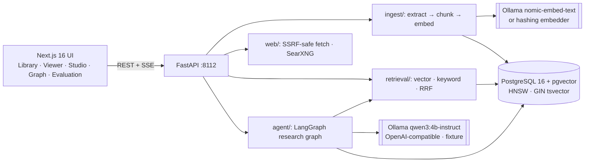
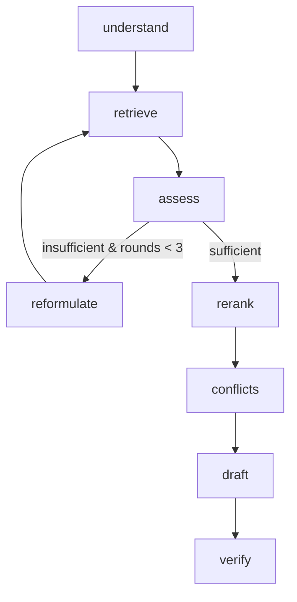

# Architecture

## Research graph

| Node | What it does | LLM? |
|---|---|---|
| understand | intent, 1-3 queries, optional collection restriction | yes |
| retrieve | hybrid search per query; strips instruction-like sentences (quarantine) | no |
| assess | evidence sufficiency = question-term coverage of top passages (≥ 0.6) | no |
| reformulate | new queries; bounded to 3 rounds | yes |
| rerank | RRF score blended with term coverage; assigns refs P1..P6 | no |
| conflicts | candidate pairs (same policy id, or similar + shared terms, with differing numbers/negation); newer by effective date; LLM confirms (≤ 2 calls) | yes |
| draft | claims with passage refs, or abstention; evidence wrapped in `<evidence>` as data | yes |
| verify | per-claim support checks (see CITATION_VERIFICATION.md); answer status | no |

Every node records a trace entry (timings, queries, counts, decisions). Model reasoning
is not requested or stored.

## Storage

One PostgreSQL database: `collections`, `documents`, `document_versions` (status
pending/processing/ready/failed, sha256, embedding model), `passages` (page, section,
char offsets, `vector(768)` with HNSW cosine index, generated `tsvector` with GIN),
`research_sessions` (answer, evidence, quarantined text, trace, LLM usage). Original files
are stored on disk under server-generated paths. Only the latest ready version of each
document is searchable.
